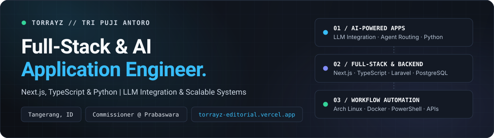

  

  <a href="https://torrayz-editorial.vercel.app"><strong>Portfolio</strong></a>
  &nbsp;·&nbsp;
  <a href="https://torrayz-editorial.vercel.app/projects"><strong>Projects</strong></a>
  &nbsp;·&nbsp;
  <a href="https://torrayz-editorial.vercel.app/contact"><strong>Collaborate</strong></a>

---

### About

I'm **Tri Puji Antoro (`Torrayz`)**, a full-stack developer and Informatics undergraduate at **Universitas Pamulang (UNPAM)**, based in Tangerang, Indonesia.

I'm the **Commissioner** of **CV. Prabaswara Gandar Prima**, which I built together with my brother **Syahri Muladiyanto**, the company's **Director**.

I treat architecture, interface, and operations as one unified process — **Design → Build → Deploy** — shipping systems that stay maintainable from database schema to user experience.

---

### How I Solve Problems

| Domain | Engineering Approach | Core Stack |
| :--- | :--- | :--- |
| **Full-Stack & Mobile** | End-to-end web and mobile products with clear state, auth, and responsive UI | `Next.js 16` · `React 19` · `TypeScript` · `React Native` · `PHP` |
| **Backend & Data** | Structured relational schemas, Row-Level Security, and decoupled APIs | `Node.js` · `Express` · `Go` · `PostgreSQL` · `Supabase` · `MySQL` |
| **DevOps & Linux** | Reproducible developer environments, server setup, and native desktop tooling | `Arch Linux` · `i3 / Sway` · `Docker` · `Nginx` · `PowerShell` |
| **Applied AI & Tooling** | Practical ML workflows, LLM routing, and local developer automation | `Python` · `FastAPI` · `Random Forest` · `LLM Agents` |

---

### GitHub Snapshot

  

---

### Core Stack

  <strong>Frontend &amp; Mobile</strong> 
  
  
  
  
  

  <strong>Backend, Data &amp; AI</strong> 
  
  
  
  
  
  
  

  <strong>Systems &amp; Operations</strong> 
  
  
  
  

---

  Built with intention, engineered for clarity. · Open for technical discussions &amp; system collaborations via <a href="https://torrayz-editorial.vercel.app/contact">torrayz-editorial.vercel.app</a>

