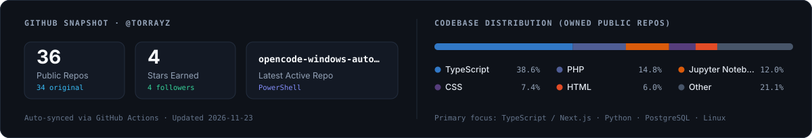

  

  <strong>Full-Stack &amp; AI Application Engineer</strong> · Next.js, TypeScript &amp; Python · LLM Integration &amp; Scalable Systems

  <a href="https://torrayz-editorial.vercel.app"><strong>Portfolio</strong></a>
  &nbsp;·&nbsp;
  <a href="https://torrayz-editorial.vercel.app/projects"><strong>Projects</strong></a>
  &nbsp;·&nbsp;
  <a href="https://torrayz-editorial.vercel.app/contact"><strong>Collaborate</strong></a>

---

### About

I build **AI-powered applications** and **scalable full-stack web systems** by combining software engineering with practical AI technologies. My focus includes integrating LLM APIs and agent workflows, developing AI-driven features, and architecting reliable backend services that solve real-world problems.

Based in Tangerang, Indonesia, I am an Informatics undergraduate at **Universitas Pamulang (UNPAM)** and serve as **Commissioner** at **CV. Prabaswara Gandar Prima**, which I built together with my brother **Syahri Muladiyanto**, the company's **Director**.

- **Currently working on:** LLM workflow orchestration and model-routing tooling, full-stack web platforms for **CV. Prabaswara Gandar Prima**, and applied ML research for my undergraduate thesis.

---

### Engineering Experience & Focus

- **AI-Powered Applications & LLM Workflows** — Integrated LLM APIs, custom model-routing proxies, and AI-driven features using Python, Node.js, and React; built applied machine learning pipelines and automated local AI agent workflows to streamline developer productivity.
- **Full-Stack Web Platforms (`CV. Prabaswara Gandar Prima` & Product Systems)** — Designed and shipped end-to-end web applications using Next.js, TypeScript, Laravel, and PostgreSQL/Supabase, implementing Row-Level Security (RLS), role-based staff authentication, and responsive user interfaces.
- **Backend Services & Workflow Automation** — Built decoupled FastAPI and Node.js backend services for structured data screening, alongside cross-platform OS automation across Arch Linux (`i3/Sway`, native GTK3 utilities) and Windows (`PowerShell` Task Scheduler).

---

### Specialization Domains

Instead of treating tools in isolation, my work is organized around the types of solutions I build:

| Solution Domain | Function & Capabilities | Core Stack |
| :--- | :--- | :--- |
| **AI-Powered Applications** | LLM API integration, model-routing gateways, agent workflow orchestration, and applied ML pipelines | `Python` · `Node.js` · `FastAPI` · `Random Forest` · `LLM APIs` |
| **Scalable Web Systems** | Full-stack web platforms, editorial CMS workspaces, commerce flows, and role-authenticated dashboards | `Next.js` · `React` · `TypeScript` · `Tailwind CSS` · `Laravel` |
| **Backend & Data Engineering** | Relational schema architecture, Row-Level Security, REST APIs, and structured market/data screening | `PostgreSQL` · `Supabase` · `Express` · `PHP` · `MySQL` |
| **Systems & Automation** | Reproducible Linux desktop environments, container deployments, and zero-touch OS boot automation | `Arch Linux` · `Docker` · `Nginx` · `PowerShell` · `GTK3` |

---

### GitHub Snapshot

  

---

### Core Stack

  <strong>Frontend &amp; UI</strong> 
  
  
  
  
  

  <strong>Backend, Data &amp; AI</strong> 
  
  
  
  
  
  
  

  <strong>Systems &amp; Operations</strong> 
  
  
  
  

---

  Built with intention, engineered for clarity. · Curated case studies &amp; project breakdowns live at <a href="https://torrayz-editorial.vercel.app">torrayz-editorial.vercel.app</a>

